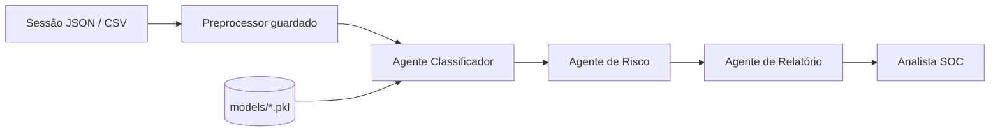
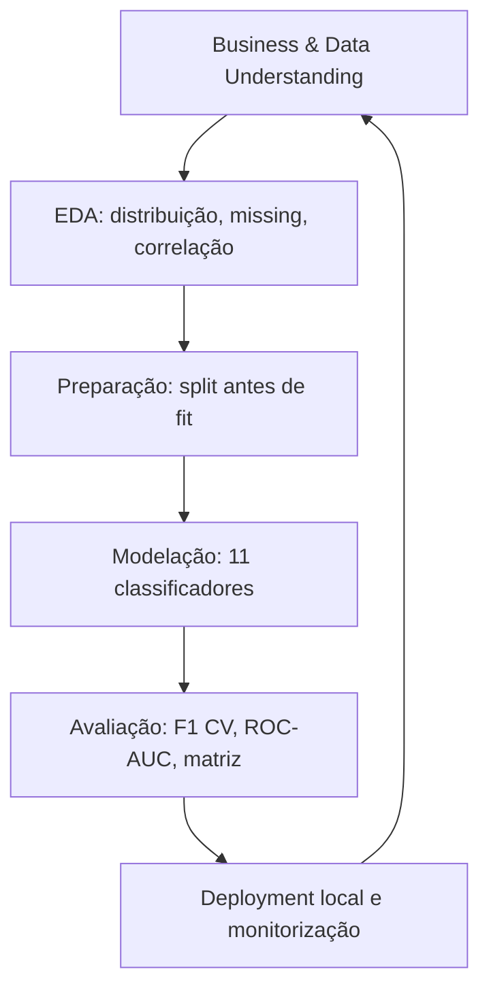
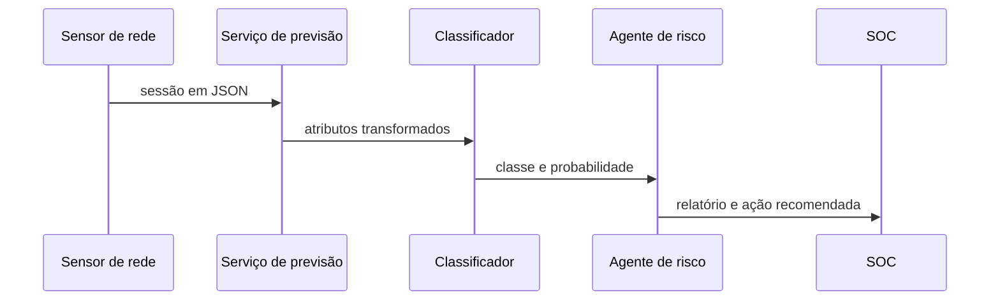

# Entregáveis do projeto IAAC

## Escopo e rastreabilidade

O sistema classifica sessões de rede em `attack_detected` (0: normal, 1: intrusão). O repositório contém um dataset. A especificação pede um dataset por elemento do grupo; antes da entrega, cada colega deve acrescentar o seu dataset validado e executar a mesma pipeline, ou declarar formalmente que o grupo é de um elemento. Não se devem inventar resultados para datasets que não existem neste repositório.

| Requisito | Evidência no repositório |
|---|---|
| CRISP-ML e EDA | `notebook/01_Data_Understanding.ipynb`, `notebook/02_Data_Preparation.ipynb` |
| Preparação | `scripts/data_prep.py`: split estratificado, imputação, IQR capping, one-hot e normalização |
| Classificação | `scripts/train.py`: 11 modelos, incluindo SVM, ensembles e XGBoost quando instalado |
| Avaliação | `scripts/evaluate.py`: matriz de confusão, precision, recall, F1, ROC-AUC, CV e diagnóstico |
| Deployment | `main.py` e `scripts/predict.py` |
| Sistema multiagente | `scripts/agent.py`: agentes de classificação, risco e relatório |

## Arquitectura multiagente



## Fluxo CRISP-ML



## Caso de uso



## Product backlog e Scrum

| ID | User story | Critério de aceitação | Sprint |
|---|---|---|---|
| US-01 | Como analista, quero compreender a qualidade dos dados. | EDA reproduzível com missing, distribuições e correlações. | 1 |
| US-02 | Como cientista de dados, quero preparar dados sem leakage. | Split antes do fit; artefacto serializado. | 2 |
| US-03 | Como analista, quero comparar classificadores. | Tabela com F1/ROC-AUC/CV para todos os modelos. | 3 |
| US-04 | Como equipa SOC, quero uma previsão explicada. | CLI recebe JSON e devolve risco/ação. | 4 |
| US-05 | Como equipa, quero rastreabilidade de decisões. | Documentação técnica, diagramas e métricas versionadas. | 4 |

Em cada aula, preencham no template fornecido pelo docente: participantes, impedimentos, trabalho concluído, próximo trabalho, Sprint Review e Retrospective. Criem as issues correspondentes no GitHub e atribuam-nas à pessoa que executou a tarefa; isso não pode ser fabricado por código local.

## Como executar

```powershell
python -m pip install -r requirements.txt
python main.py
python scripts/predict.py --session '{"network_packet_size":599,"protocol_type":"TCP","login_attempts":4,"session_duration":493,"encryption_used":"DES","ip_reputation_score":0.61,"failed_logins":1,"browser_type":"Edge","unusual_time_access":0}'
```

`main.py` recria os artefactos em `models/`: dados preparados, modelos e `model_metrics.csv/json`. A seleção é feita pelo F1 médio em validação cruzada estratificada; o teste é reservado para a avaliação final.

## Estrutura do relatório humano (25–30 páginas)

1. Problema, contexto de cibersegurança e critérios de sucesso.
2. Dados: proveniência, limitações, privacidade e EDA.
3. CRISP-ML: preparação e justificação das decisões.
4. Modelos e protocolo experimental.
5. Resultados, erro, overfitting e seleção.
6. Arquitectura multiagente, caso de uso e deployment.
7. Limitações, riscos e monitorização futura.
8. Conclusão, referências e anexos essenciais.

O relatório a submeter deve ser redigido e revisto pelo grupo, conforme a regra do enunciado de não usar IA generativa. Este ficheiro é documentação técnica do código, não substitui esse relatório nem o histórico de trabalho no Classroom/GitHub.
