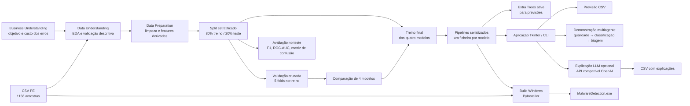

# Arquitetura da pipeline

O projeto inclui um dataset. O diagrama representa as fases existentes, desde
CRISP-ML até à previsão/deployment local.

## Componentes e pontos de entrada

- `src/eda.py`: análise exploratória e artefactos em `results/`.
- `src/train.py`: validação cruzada, treino e serialização dos quatro modelos;
  Extra Trees mantém-se como o modelo ativo para previsões.
- `src/evaluate.py`: comparação na partição de teste e relatórios.
- `src/predict.py`: aplicação do modelo a linhas de CSV.
- `src/multiagent.py`: demonstração local com agente de qualidade, agente de
  classificação e agente de triagem coordenados sequencialmente.
- `src/app.py`: interface gráfica que disponibiliza estes fluxos.
- `build_windows.ps1`: criação do executável Windows, que inclui o modelo
  Extra Trees predefinido; os modelos treinados e relatórios são escritos na
  pasta de dados local do utilizador.

O sistema multiagente é uma demonstração determinística baseada no modelo
existente; não usa LLM, serviços externos, análise dinâmica ou execução de
ficheiros. Os limiares da triagem são ilustrativos e não foram calibrados como
política operacional.

A opção separada **Explicar previsões com LLM** envia à Gemini Developer API
apenas a classificação, a probabilidade e a faixa de triagem por linha.
A LLM não influencia as previsões. A opção requer Internet e uma chave da
Gemini Developer API configurada no computador onde a aplicação é executada;
a chave não é incluída no executável. O nível gratuito está sujeito aos limites
e às condições atuais do fornecedor.
